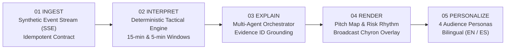
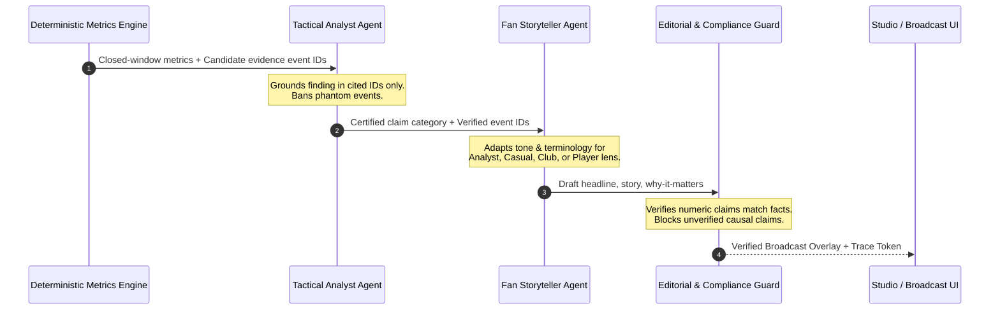

# The Invisible Game
### Explainable AI Match Intelligence for Football Broadcasts & Fans

[](https://github.com/raslmm/invisible-game-hackathon/actions/workflows/ci.yml)
[](https://www.python.org/)
[](https://learn.microsoft.com/en-us/azure/ai-foundry/)
[](#technology-stack)
[](LICENSE)

**See the game under the game.** *The Invisible Game* transforms a continuous stream of football-realistic synthetic match events into explainable tactical intelligence, automated full-time recaps, on-air broadcast chyrons, and personalized stories for analysts, casual fans, club supporters, and player scouts.

Its central question: **Control or Chaos?** The system mathematically separates a persistent spell of defensive exposure from an isolated dangerous counter-attack, backing every claim with cited source event IDs and verifying numerical fidelity against hallucination.

---

## Architecture & Intelligence Pipeline



### Multi-Agent Collaborative Architecture



The system employs three bounded, collaborative agent roles:
1. **Tactical Analyst Agent** (`agents/tactical_analyst.json`): Assesses exposure signals across rolling 5-minute sub-windows, binding the tactical finding strictly to allowed source event IDs.
2. **Fan Storyteller Agent** (`agents/fan_storyteller.json`): Translates verified telemetry into audience-specific language (Analyst Desk, Casual Fan, Club Lens, Player Focus) in English or Spanish.
3. **Editorial & Compliance Guard Agent** (`agents/editorial_guard.json`): Validates numeric claims, citation integrity, character budgets, and enforces anti-hallucination policies (banning unverified causal leaps such as *"caused a goal"* or predictive assertions).

---

## Quickstart & Demo

Requires Python 3.10 or newer. The replay engine, metrics pipeline, agent workflow, and web application run out-of-the-box using the Python standard library; no third-party package installation or cloud credentials are required for local evaluation.

### Option A: Local Python Server

```powershell
# 1. Start the application
python scripts/run_app.py

# 2. Open in your browser
# Navigate to: http://127.0.0.1:8765
```

### Option B: Docker Container

```powershell
docker compose up --build
# Open http://localhost:8765
```

### Option C: 1-Click Azure Cloud Deployment

The repository includes Infrastructure as Code (Bicep & ARM templates) in [`infra/`](infra/):

```powershell
az containerapp up `
  --name invisible-game-live `
  --resource-group rg-invisible-game `
  --location eastus `
  --source . `
  --target-port 8765 `
  --ingress external
```

---

## Exploring the Match Replay

1. **Select a Match Scenario**:
   - `IGM001` (*Transitional Chaos*): Demonstrates a transient dangerous spell (W2) followed by sustained, repeated defensive exposure (W3–W6).
   - `IGM002` (*High-Turnover Control*): Demonstrates how a high volume of turnovers does **not** equal danger if defensive cover and recovery speed remain intact.
2. **Replay Controls**: Adjust speed (60×, 120×, 240×), pause, resume, or reset.
3. **Switch Personas & Languages**: Toggle between *Analyst Desk*, *Casual Fan*, *Club Lens*, and *Player Focus*, or switch to *Español*. Notice that underlying source event citations and metrics remain invariant.
4. **📺 Broadcast Chyron**: Click the **Broadcast Chyron** button to inspect a broadcast-ready lower-third television graphic with live telemetry and certified compliance status.
5. **Full-Time Automated Recap & Export**: Once replay concludes, view the structured match recap and click **Export match JSON** to download machine-readable analytical payloads.

---

## Technology Stack & Microsoft Azure Integration

- **Core & Runtime**: Python 3.10+ standard library (`http.server`, `urllib`, `dataclasses`, `json`, `csv`, `threading`). Zero external runtime dependencies.
- **Frontend**: Vanilla HTML5, CSS3, and JavaScript with Server-Sent Events (SSE) streaming, interactive SVG pitch markings, and dynamic bar rhythm charts.
- **Microsoft Azure AI Foundry & Azure OpenAI**:
  - Connects to the Foundry Models OpenAI-compatible v1 chat-completions endpoint for LLM-powered narrative adaptation.
  - When credentials are not configured, an offline deterministic template engine handles the workflow seamlessly.
  - To enable live model calls, copy `.env.example` to `.env` and fill in your Azure endpoint, key, and deployment name:
    ```env
    AZURE_AI_FOUNDRY_ENDPOINT="https://<your-resource>.openai.azure.com"
    AZURE_AI_MODEL_DEPLOYMENT="gpt-4o-mini"
    AZURE_INFERENCE_CREDENTIAL="<your-api-key>"
    ```

---

## Data Provenance & Evaluation

All match fixtures, club identities, player rosters, and events are 100% synthetic and football-realistic. No real Premier League match data or proprietary tracking feeds are used.

- **60 Matches** across 12 distinct tactical scenario archetypes.
- **17,280 Events** with x/y pitch coordinates, pressure indices, recovery speed metrics, and defenders behind ball.
- **1,320 Players** with positions and squad affiliations.
- **360 Evaluated Windows** with ground-truth exposure labels.

### Validation & Benchmark Suite

Verify data integrity and scenario cross-validation:

```powershell
# Check schema and synthetic data constraints
python scripts/validate_data.py

# Run scenario-grouped benchmark evaluation
python scripts/evaluate.py

# Run comprehensive test suite (21 unit & integration tests)
python -m unittest discover -s tests -v
```

---

## Command-Line Replay Tools

Stream event envelopes as JSON Lines to stdout:

```powershell
python scripts/replay_match.py --match-id IGM001 --speed 60 --limit 20
```

Run match analysis without loading labels:

```powershell
python scripts/analyze_match.py --match-id IGM001
```