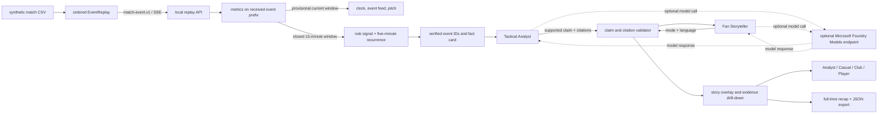

# Architecture and operating boundaries

## Event-to-story path

## Replay contract

The browser first fetches match and roster metadata. It then opens a local Server-Sent Events stream. The server emits one versioned `match-event.v1` envelope at a time using the existing timestamp-ordered replay source. Pause closes the stream; resume starts at the next event index. Duplicate event IDs are removed by `EventReplay` within that run.

For each new event, the metrics engine receives only the event prefix that has arrived so far. It sends provisional values for the incomplete 15-minute window. The app never treats that partial score as a published insight. At a window boundary, the server sends the closed window, its recurrence count, and its cited event IDs. At full time, it closes the last partial window and builds the recap. This makes the local replay a real event-by-event simulation; it is not a connection to a broadcaster's live feed.

The development dataset has 288 events per match. The server currently recomputes metrics over the received prefix for clarity and deterministic behavior at this scale. A production feed should use a stateful one-pass accumulator, backpressure, durable checkpoints, a streaming broker, and separately measured latency budgets.

## Narrative guardrails

- The deterministic engine alone calculates counts, averages, rule scores, and recurrence.
- Each narrative request receives one structured finding, its fact card, and only the associated source event records.
- The Tactical Analyst may select only the supported claim type and supplied event IDs.
- The Fan Storyteller may change audience framing and language but must return evidence IDs from the Analyst's verified subset. A validator checks the category, citations, response shape, length, and numeric claims.
- Invalid output, network failure, or absent credentials selects a deterministic local template. Model calls never stop the event stream.
- Request traces record stage, status, verified citation count, elapsed time, and request ID. The stream reports per-event metric-processing time; the browser shows event-to-overlay response time. They do not log prompts or credentials.

The model adapter uses the Microsoft Foundry Models OpenAI-compatible v1 chat-completions route over HTTPS. It needs `AZURE_AI_FOUNDRY_ENDPOINT`, `AZURE_AI_MODEL_DEPLOYMENT`, and `AZURE_INFERENCE_CREDENTIAL`, set in the process environment or the ignored local `.env`. Model output is optional and is not represented as Microsoft Agent Framework orchestration.

## HTTP surface

| Route | Use |
| --- | --- |
| `GET /api/health` | Local status and whether optional model settings are complete. |
| `GET /api/matches` | Safe match metadata for the selector. Does not return labels. |
| `GET /api/matches/{id}/metadata` | One match and its synthetic roster, without future events or analysis. |
| `GET /api/matches/{id}/stream?from=0&speed=120` | Typed event-by-event SSE stream with provisional current-window metrics and newly closed windows. |
| `POST /api/narrative` | Evidence-grounded role workflow for one insight and a selected audience. |
| `POST /api/recap` | Full-match narrative chapters and player highlights after replay. |
| `GET /api/export/{id}` | Explicitly requested versioned JSON export of the synthetic match and analysis. |
| `GET /api/traces` | Recent, sanitized in-memory workflow traces. |

The service binds to `127.0.0.1` by default and has no user accounts or database. Do not expose it to the public internet as-is.

## Data and truth boundary

All source rows, player names, teams, labels, and dates are fictional. Ground-truth labels are used only by the offline evaluator and notebook. The interactive metadata and stream responses do not include labels. The rule score is an interpretable development signal, not a calibrated probability.

No pass endpoints, ball-speed measures, player tracking, or video are present in the supplied files. Consequently the app does not claim to measure pass difficulty, player speed/distance, or to auto-event video. These should be added as a separately documented synthetic data extension before their use is claimed.
